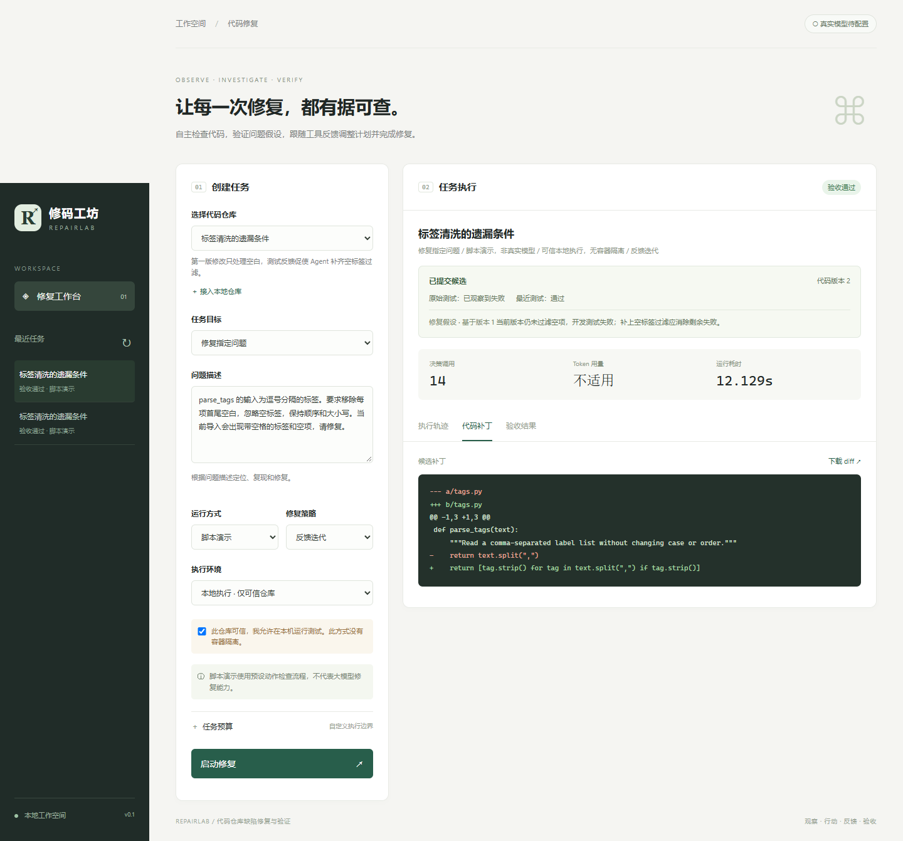

# 修码工坊 · RepairLab

[](https://github.com/yycf1/repairlab/actions/workflows/ci.yml)

面向 **Python / pytest 仓库**的自主诊断与修复 Agent。用户可以选择仓库直接开始检查，也可以指定缺陷；模型根据源码、文档和工具结果提出并验证问题假设，更新计划、修复实现，最终交付调查证据和经过验证的补丁。

重点是形成可追溯的修复闭环：模型决定下一步，控制器约束动作和预算，工具执行搜索/编辑/测试，最终验证器在干净副本中重新应用补丁并验收。

- **先复现再修改**：自主检查先引用行为约定，原始快照确认复现失败后才能进入修复。
- **测试绑定当前补丁**：修改或撤销使旧测试证据失效，提交前核对源码摘要与版本。
- **逐用例验收**：记录 pytest 节点和各阶段结果，关键用例缺失、过滤或跳过都会拒收；不从终端的成功字样推断验收通过。
- **可回放交付**：工作台查看计划、失败反馈、Git diff、用例结果及执行记录，支持取消、SSE 重连与产物下载。



## 快速运行

Windows 可直接双击项目根目录的 **`启动工作台.cmd`**。启动器检查服务是否已经运行，等待 HTTP 页面就绪，再自动打开浏览器；服务已运行时直接打开现有实例。新启动时请保留控制台窗口，按 Ctrl+C 可停止服务。

工作台地址是 **<http://127.0.0.1:8766/>**。不要直接打开 `src/repairlab/web/index.html`，它需要由后端提供静态资源和 API；也不要使用项目1的地址或其他端口。

要求 Python 3.11+、[uv](https://docs.astral.sh/uv/) 和 Git。Windows PowerShell：

```powershell
git clone https://github.com/yycf1/repairlab.git
cd repairlab
uv sync --frozen --extra dev
.\启动项目.ps1
```

Linux/macOS：安装同样依赖后运行 `uv run repairlab serve`。系统文件夹选择器仅在 Windows 可用，其它系统可通过 CLI 的 `--profile` 接入仓库。

浏览器打开 <http://127.0.0.1:8766>。选择样例和“脚本演示”，在可信内置样例上勾选本地执行确认，再启动任务。界面可查看计划、工具记录、失败测试、补丁和验收报告。

“真实模型待配置”不会影响界面和脚本演示。真实模型运行需填写本项目 `.env`。

无界面演示：

```powershell
uv run repairlab run --fixture csv-tags --mode demo --backend local --allow-local
uv run repairlab evaluate --backend local --allow-local
uv run python scripts/evaluate_offline.py --backend local --allow-local --output .data/demo-evidence.json
```

`csv-tags` 演示刻意让第一版补丁遗漏空项，再根据失败测试修正。演示使用确定性脚本，不能据此报告大模型修复率。`single_shot` 表示第一版成功编辑后立即验收；仍可能有多次前置阅读调用，并非单次模型调用。

## 独立模型配置

复制 `.env.example` 为本项目 `.env`，填写后重启服务，选择“真实模型”：

```dotenv
REPAIRLAB_MODEL=你的模型名称
REPAIRLAB_BASE_URL=https://你的兼容接口/v1
REPAIRLAB_API_KEY=你的密钥
```

使用兼容 Chat Completions 的文本消息接口。模型须能输出规定的 JSON 动作，不依赖厂商的原生工具调用协议。

临时借用另一份配置测试而不复制密钥：

```powershell
uv run python scripts/smoke_model.py --env-file 'E:\其他项目\.env' --key-name LLM_API_KEY --base-url https://你的兼容接口/v1 --model 你的模型 --backend local --allow-local
```

此命令只在当前进程读取指定密钥，不生成项目2的 `.env`。认证头及供应商错误正文不落库，日常启动仍读取自己的配置。

## 自主检查并修复

接入自己的仓库后，默认选择“自主检查并修复”。“检查关注点”可以留空，也可指定关注的模块或边界输入；系统不会把仓库预存的问题描述填入自主任务。选择真实模型和执行环境后启动。

Agent 自主选择搜索、阅读、测试、登记候选、构造复现、调整计划及修改等动作。候选必须引用已读的行为依据，先在原始快照上复现断言不匹配，再关联当前版本修复假设进入修改；复现不能事后改写。修改后同一复现和原有测试均须通过，最终验证器还会在应用补丁的干净副本中重跑复现。生成的测试是模型对行为要求的解释，**不属于独立验收依据**。

候选可以被否定或标记证据不足。没有补丁的调查以“检查完成 · 未提交补丁”结束，不会显示“验收通过”，也不证明仓库没有问题。原有指定问题模式和脚本演示保留；自主检查仅使用真实模型和反馈迭代策略。

本轮在首次编辑前完成候选发现，最多登记八项；新的调查方向可创建下一轮任务。当前仍要求仓库具备可运行的 pytest 测试，不支持无人监督的长期巡检、自动安装依赖或任意执行 shell。详见 [自主诊断实现说明](docs/自主诊断实现说明.md)。

## 执行环境

默认后端为 Docker。本地执行必须显式允许，只用于可信仓库，没有代码隔离能力。

```powershell
docker build -f Dockerfile.runner -t repairlab-python:latest .
uv run repairlab run --fixture csv-tags --mode model --backend docker
```

Docker runner 禁网、只读挂载仓库、采用非 root 用户，限制 CPU、内存、进程数和命令时间。模型在宿主进程调用接口，密钥不注入测试容器；编辑由宿主受限文件工具完成。

开发机未安装 Docker；仓库提供 Linux CI 实机检查，验证非 root、只读挂载、禁网、超时清理及完整修复演示。实际状态与证据以 [CI 运行记录](https://github.com/yycf1/repairlab/actions) 和 [评测说明](docs/evaluation/README.md) 为准。内置镜像仅有 pytest；外部依赖应由操作员预先准备专用镜像，Agent 不联网安装依赖。

## 接入自己的仓库

网页点击 **“接入本地仓库 → 选择文件夹”**，在 Windows 系统目录窗口中选择代码目录。系统自动识别项目名称、Python 源码、测试目录和 pytest 配置，展示识别结果并进行静态预检，通常直接点击“接入仓库”即可。名称、路径和源码规则无需手填；特殊结构、未识别到的测试或自定义验收可在折叠的“高级设置”中调整。配置保存在本机 SQLite，后续可直接选择或修改。三个内置演示继续保留；自有仓库使用真实模型模式。

预检检查快照大小、UTF-8 文件、源码范围、测试目标、Git、执行环境的 Python 版本和识别到的直接依赖。环境未准备好时可保存有效的仓库配置，补齐依赖后点击“检查环境”。“收集测试”在临时副本执行 pytest --collect-only，会导入仓库代码，需选择 Docker 或明确允许可信仓库本地执行。每次创建自有仓库修复任务时都会重新预检，报告保存当次仓库配置和检查结果。

本地测试使用 RepairLab 的 Python 环境，Docker 使用指定的已准备镜像；预检不会自动安装依赖或拉取镜像。支持静态 `project.dependencies`、`requires-python`、根目录 `requirements.txt` / `requirements-dev.txt`；其他依赖组织方式会提示人工核对。详见 [本地仓库接入说明](docs/本地仓库接入说明.md)。

CLI 也支持自有配置，参考 [配置模板](docs/repository-profile.example.json)：

```powershell
uv run repairlab run --profile .\my-repo.json --mode model --backend docker
```

`source` 和 `acceptance` 相对配置文件解析。验收目录应在 Agent 工作副本之外；没有外置验收集时，报告明确标记 `independent_acceptance: false`，仅在干净副本重跑开发及回归测试。

工作台高级设置或 profile 中可填写 `required_acceptance_tests` 与 `required_regression_tests`，指定必须通过的完整 pytest 节点。三个内置样例已列出全部验收和回归节点；自有仓库缺省清单为空，需维护者依据行为要求配置。详见 [结构化验收与关键用例](docs/结构化验收与关键用例.md)。

首版快照限 500 个支持的文本文件 / 8 MB，忽略隐藏目录、凭据文件及 Git 历史。只能编辑已存在的白名单 Python 源文件，不能改测试、配置或新建/删除文件。其他语言、二进制资源和复杂构建系统尚未适配。

## 实现结构

```text
src/repairlab/
  _vendor/mini/       固定版本的上游 Agent 核心
  agent.py           控制器钩子、预算、终止条件
  model.py           模型协议、JSON 校验、上下文裁剪、演示适配器
  repository.py      快照、代码定位、受限编辑、diff
  preflight.py       本地仓库配置、环境及可选测试收集检查
  discovery.py       从文件结构及项目配置识别源码和测试
  directory_picker.py Windows 系统文件夹选择（独立 STA 进程）
  tools.py           结构化工具执行与反馈分类
  investigation.py   候选问题、不可改写的复现、版本绑定证据
  runners.py         本地 / Docker pytest 执行
  pytest_evidence.py pytest 节点和阶段结果记录插件
  test_evidence.py   结构化报告校验、关键用例通过规则
  verification.py    干净副本应用补丁、验收和回归
  storage.py         SQLite 任务及事件记录
  service.py         后台任务、取消、产物导出
  api.py + web/      FastAPI / SSE 工作台
examples/            三个自建缺陷仓库及外置验收集
third_party/         开源许可、版本和来源校验
tests/               行为、约束及端到端测试
```

产物在 `.data/tasks/<任务ID>/`，包括原始快照、开发副本、验证副本，以及 `artifacts/patch.diff` 和 `report.json`。SQLite 保存事件，SSE 支持事件游标重连。重启后未完成任务标为中断，历史可回看；尚无执行现场续跑。数据目录通过进程锁避免服务和 CLI 同时占用；并行运行须指定不同 `REPAIRLAB_DATA_DIR`。

预算在调用边界检查：Token 使用供应商 usage，可能超出阈值一个请求，也无法计入未返回 usage 的调用；Agent 时限在步骤间检查，最终验收另受每条测试时限约束。上下文按字符裁剪，保留系统规则、问题、当前计划和最近八条消息，不是精确 token 计算。

## 开源基础及二次开发

选用 [mini-swe-agent](https://github.com/SWE-agent/mini-swe-agent) 的小型 Agent 循环，固定 commit `04d809ceab9df28f9adaed044884180159172930`，实际复用代码位于 `_vendor/mini/`。未复制上游完整产品或 Git 历史。

新增结构化代码工具、源文件修改约束、测试反馈分类、独立补丁验收、预算和取消、SQLite/SSE 任务记录、自有工作台，以及自建缺陷和验收集。详见 [选型及改造说明](docs/开源选型与改造说明.md)。

界面、示例和配置未沿用上游个人资料或宣传内容。MIT 要求的原始版权声明保存在 [许可证](third_party/mini-swe-agent/LICENSE.md)，版本及哈希记录在 [source.json](third_party/mini-swe-agent/source.json)。

## 验证与面试准备

```powershell
uv run pytest -q
uv run ruff check .
```

- [架构说明](docs/架构说明.md)：为什么是 Agent、模型和控制器的职责。
- [项目流程与实现思路](docs/项目流程与实现思路.md)：状态、证据、修改及提交条件，失败恢复与从头构建顺序。
- [标签修复流程走查](docs/标签修复流程走查.md)：来自实际演示的 14 步动作和反馈，观察第一版补丁如何被测试纠正。
- [面试讲解与复现路线](docs/面试讲解与复现路线.md)：设计取舍及后续补充。
- [验证记录](docs/验证记录.md)：已经实测与仍需验证的能力。
- [结构化验收与关键用例](docs/结构化验收与关键用例.md)：为何退出码成功不等于修复有效。
- [评测口径与复跑](docs/evaluation/README.md)：固定六条机制场景与四条对抗性控制场景、逐短码控制统计、Docker 检查与真实模型评测边界。

当前可复跑演示使用三个自建缺陷和确定性脚本，不是外部仓库 benchmark。历史真实模型冒烟独立记录，不宣称 50 个任务或 68% 修复率。上游 MIT 许可及修改范围见下方链接与第三方声明。
