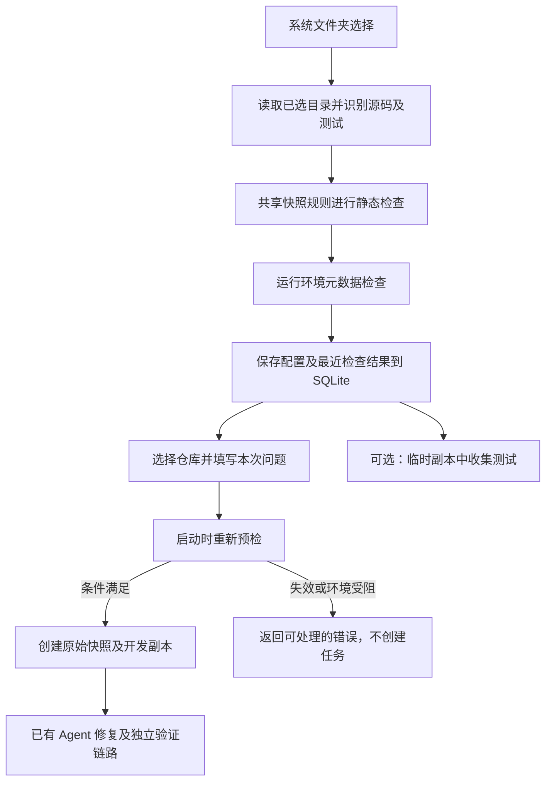

# 本地仓库接入说明

2026-10-12：第一步交付，并简化为选择文件夹、自动识别配置的接入方式。

## 从网页接入

1. 打开 <http://127.0.0.1:8766/>，点击“接入本地仓库”。
2. 点击“选择文件夹”，使用 Windows 系统目录对话框选择代码仓库。取消选择会保留之前的配置。
3. 系统读取文件结构及项目配置，识别项目名称、可修复源码、测试文件和测试位置，自动检查环境。通常无需展开高级设置。
4. 确认识别结果，点击“接入仓库”。结构错误会阻止保存，环境错误允许先保存后准备依赖；未发现测试时，会展开高级设置并只提示补充缺失的测试位置，或先为仓库添加测试。
5. 在“我的本地仓库”中选择已登记项目，可“修改配置”“检查环境”或“收集测试”。配置刷新后及服务重启后均保留。
6. 补齐本项目独立模型配置，填写本次问题并启动。自有仓库没有预设演示动作，使用真实模型模式。

名称、说明、源码范围、测试目标、默认问题、外置验收和 Docker 镜像都放在高级设置。目录选择不可用时，可在高级设置填写绝对路径并点击“读取并识别”。自定义源码每行一个相对路径或 glob，测试每行一个相对路径或 pytest 节点，不接受 shell 命令及 pytest 参数。问题描述在创建修复任务时填写，不必在接入阶段重复填写。

目录指这台运行 RepairLab 的电脑上的目录。当前没有浏览器文件上传、GitHub 克隆、网络共享目录、磁盘根目录或任意命令执行入口。

## 自动识别的依据

- 名称优先读取 pyproject.toml 项目元数据或 setup.cfg 的静态名称，缺失时使用文件夹名称；不执行 setup.py。
- 扫描规则与实际任务快照一致，排除隐藏目录、虚拟环境及 Git 历史。自动生成已识别 Python 源文件的精确修改范围，排除测试、配置、文档示例、构建输出和第三方目录。
- 优先参考 pytest.ini、pyproject.toml、setup.cfg、tox.ini 的 pytest 配置，识别 testpaths 和 python_files；缺失时识别常见测试目录、test_*.py 和 *_test.py。
- 自定义命名的测试也会加入保护清单；即使高级设置扩大源码规则，已识别测试及测试目录内的辅助代码仍受保护。
- 回归默认覆盖所有识别到的测试。没有找到测试时明确阻止直接接入，不虚构测试目录，也不声称缺陷已经复现。

Windows 选择器使用独立 STA 子进程中的 IFileOpenDialog，仅选择真实文件系统目录，不依赖额外 GUI 库；同一服务同时只打开一个选择窗口。取消、超时和异常会释放选择状态，超时会结束选择器进程树。实现依据 [Microsoft Common Item Dialog 文档](https://learn.microsoft.com/windows/win32/shell/common-file-dialog)。

## 预检怎样工作

| 检查 | 通过条件与边界 |
| --- | --- |
| 快照 | 与实际复制共用文件清单逻辑；最多 500 个支持的 UTF-8 文本文件、8 MB 总量、500 KB 单文件；剪枝排除隐藏目录、虚拟环境和 Git 历史，限制目录遍历规模 |
| 修改范围 | 源码规则实际匹配到可修改 Python 文件；路径不越界，测试和配置始终受保护 |
| 测试目标 | 开发和回归目标存在且会进入快照；允许路径及 pytest 节点，不允许注入命令参数 |
| 外置验收 | 可选；若设置必须在源码仓库外，并含 Python 测试文件 |
| Python / 依赖 | 使用隔离的元数据探测命令，不导入仓库；检查执行环境中的 pytest、识别到的直接依赖版本及 requires-python |
| Docker | 检查 Docker 服务和本地镜像；探测容器不挂载仓库、不联网，超时后清理；显式禁止自动拉取镜像 |
| 可选测试收集 | 在临时副本执行固定 pytest --collect-only，收集开发、回归及已配置的外置验收；限制时间及输出，并清理临时副本 |

静态预检通过，只代表配置和已识别的环境条件满足要求。测试收集通过，只代表测试模块及指定节点可导入，不代表缺陷已复现或测试函数已通过。最终修复仍由开发反馈和独立验证器判断。

本地执行使用 RepairLab 自己的 Python 环境，当前不能在网页另选解释器。依赖检查识别 `pyproject.toml` 的静态 `project.dependencies` / `requires-python`，以及根目录 `requirements.txt` / `requirements-dev.txt`。不自动展开递归 requirements、动态项目元数据、可选或开发依赖组、extras 的传递依赖及构建环境，也不运行安装脚本。需要操作员预先准备依赖或专用 Docker 镜像。当前 runner 禁用第三方 pytest 插件自动加载，依赖复杂插件的仓库仍需适配。

## 如何进入修复任务

仓库登记使用独立 ID；`/api/repositories` 合并内置和自有仓库，`/api/fixtures` 保留原有演示契约。任务报告保存当次仓库配置及启动预检结果，后续修改登记配置不影响已经创建的任务。

选择文件夹或点击“读取并识别”表示允许读取该目录；无需再勾选重复的读取授权。高级设置中的手动接入接口仍要求显式授权字段。静态环境预检不导入仓库代码，不要求本地测试执行确认；实际收集或执行测试仍受执行环境选择和本地执行确认约束。接口限定本机 Host，并拒绝浏览器跨站来源发起写入请求。服务定位仍是单用户本地工作台，不提供远程认证或多租户隔离。

Agent 编辑和测试使用副本，产品不会自动将补丁写回原仓库。可信本地代码仍能访问宿主文件系统；临时副本不能替代容器隔离。未配置外置验收时，报告会明确标记 `independent_acceptance: false`。

## 本次验证

自动化覆盖无授权拒绝、跨站写入拒绝、不合法测试路径、缺失依赖及 Python 版本不符、非 UTF-8 文件、外置验收目录、配置持久化和更新、测试收集的导入错误、原仓库不变，以及登记仓库进入既有修复/验收链路。端到端修复使用确定性模型适配器验证接线，本次未新增真实模型能力评测。

浏览器验证覆盖选择取消、自动名称/源码/测试识别、默认隐藏高级设置、缺少测试时才提示补充、静态预检、保存和更新、刷新保留、测试收集、自有仓库运行模式及模型未配置提示；桌面和手机布局无横向溢出、无页面脚本错误。浏览器测试模拟系统窗口返回结果，并调用真实识别 API；系统目录窗口本身另用 Windows GUI 冒烟验证真实选择及取消。识别样例仍是自建文件，没有将其称为真实开源仓库评测。
