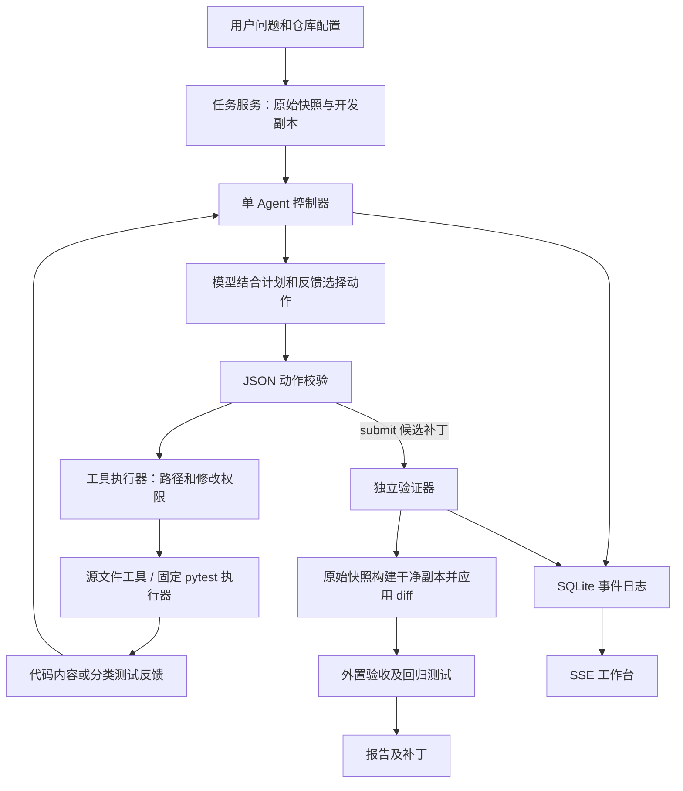

# 架构说明

自主检查模式已补充候选问题和最小复现工具，允许不提供缺陷描述创建任务。模型负责提出调查方向及更新计划，控制器要求修改前取得复现证据；没有补丁的调查以 reviewed 结束。完整边界与流程见 [自主诊断实现说明](自主诊断实现说明.md)。

2026-10-12 增补显式 WorkflowState、版本绑定测试证据、修复假设、提交条件、编辑撤销和未解决出口。完整实现思路见 [项目流程与实现思路](项目流程与实现思路.md)。

同日增加网页本地仓库登记、配置更新和持久保存、启动预检及可选测试收集。预检与任务复制共用快照清单；每次启动重新检查，任务报告保存当次配置。静态检查不导入仓库，可选收集在临时副本执行。详见 [本地仓库接入说明](本地仓库接入说明.md)。

接入交互进一步简化为系统文件夹选择及自动识别：名称、源码范围和测试目标从静态文件推断，默认只展示结果；识别不足时才补充高级配置。Windows 选择器使用独立 STA 进程，识别和预检不导入待修复仓库；真正执行测试时才要求本地执行确认。

## Agent 如何成立

真实模型根据问题、代码和已有反馈选择下一步，可以搜索、读取、修改、测试或提交；失败后自行决定重新定位还是调整补丁。`update_plan` 是可更新的外部计划，不是多个虚构专家角色。

控制器检查 Schema、预算、停止请求和提交条件，工具负责执行权限。修改前要求计划、已读源文件、原始测试和当前版本假设；反馈模式提交前要求非空补丁及与当前版本、源码摘要匹配的通过结果。脚本演示用预设决策替换模型，仅用于检查链路。

## 约束如何落实

模型不能发起任意 shell，只能调用结构化工具。只能修改白名单内已有 Python 文件，测试和配置受保护。即便开发副本绕过工具被直接篡改，最终 diff 检查仍会拒绝保护文件变更。

模型可读开发测试；最终验收集在工作副本外，提交后才由验证器注入干净副本，最终结果不会回灌本轮 Agent。本地执行的代码仍能访问宿主文件系统，只有容器模式才提供所需文件系统隔离；不能将本地运行称为隐藏验收数据的安全保证。

验证器从原始快照重建目录，经 Git 检查和应用补丁，再跑验收及回归。开发阶段产生的缓存不带入验收目录。没有外置验收集时明确标注，独立执行不等于独立测试数据。

反馈区分断言失败、环境/收集错误、超时、取消、输出超限和工具错误。模型利用有限反馈继续决策，预算耗尽或连续格式错误则终止。认证头和接口错误正文不落库。

## 取舍及限制

- 单 Agent 足以形成闭环，未为了角色数量引入多 Agent。
- Python/pytest 收敛执行协议，扩语言需要新增 runner、镜像和仓库策略。
- 编辑采用唯一片段替换，暂不支持新建模块、删除文件和复杂重构。
- 单次补丁对照在第一次成功编辑后停止，不等价于同成本的一次提示基线。
- 当前定位是文本搜索及 AST 定义提取，没有向量代码索引或调用图。
- 上下文按字符裁剪，当前计划外置保存；usage 依赖供应商，不计算金额或硬性账单上限。
- 历史可重放，但没有中断现场续跑；当前单进程恢复方式不能替代分布式任务租约。
- 容器提供一层执行约束，尚未完成对抗性安全审计。
