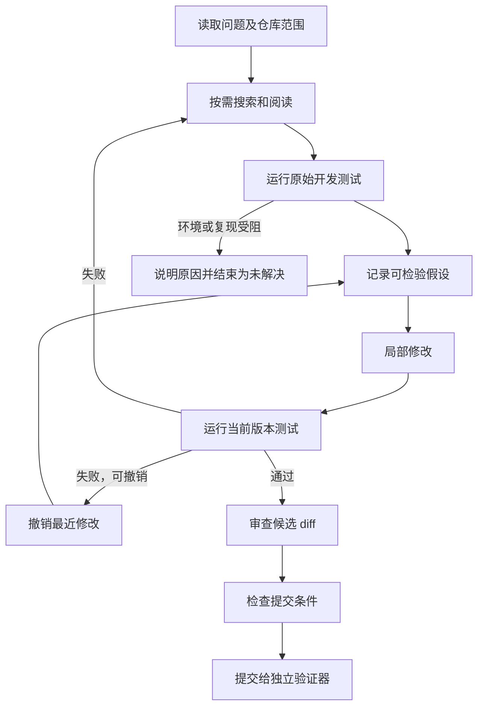

# 项目流程与实现思路

本文对应 2026-10-12 的流程增强版。重点是：每一项设计解决什么问题，如何落到代码，出了问题怎样验证。

同日新增自主检查入口、候选问题、最小复现和 reviewed 退出状态。以下章节描述修复基础循环，自主检查在编辑之前增加“发现候选 → 解释行为依据 → 复现或否定”，提交前增加同一复现的版本检查；不是由控制器按固定步骤调工具。详见 [自主诊断实现说明](自主诊断实现说明.md)。

## 1. 先定义交付物，再选择 Agent 架构

输入不只是自然语言问题，还包括确定的代码快照、可编辑范围、开发测试入口、执行环境及外置验收集。输出也不只是“已经修好”，而是候选 diff、测试证据、最终验收结果及任务轨迹。

据此把职责分成四部分：模型提出下一步动作；控制器执行规则；工具访问代码和运行测试；验证器判定补丁是否满足验收。上游 mini-swe-agent 提供基础循环，本项目扩展后三部分及适配器。

选择单 Agent，是因为定位、修改和测试需要共享同一份事实状态。当前没有证据表明增加角色能改善修复效果。先让反馈可信、边界清楚，再讨论分工。

## 2. 区分任务状态和修复状态

任务状态回答“后台任务在做什么”：queued、running、verifying、passed、failed、blocked、cancelled、budget_exhausted 等。它由服务管理，`passed` 只能由最终验证产生。

修复状态回答“现在掌握了什么”：读过哪些文件，原始测试如何，修改了哪些文件，当前代码版本，最近测试对应哪个版本，以及正在验证的假设。它由 `WorkflowState` 保存。

`phase` 是这些事实的简要展示，不是强制执行一次的阶段流水线。模型可以读完文件再列计划，也可以测试失败后回去搜索。只有有副作用的编辑和提交需要满足确定条件。

| 状态字段 | 谁产生 | 用途 |
| --- | --- | --- |
| plan | 模型提出，工具保存 | 表示当前行动安排，可以更新 |
| inspected_files | read_file 成功后记录 | 区分读过的代码和猜测的文件 |
| baseline_test | 原始版本实际测试 | 记录缺陷是否被开发测试观察到 |
| hypothesis | 模型提出，关联已读文件及最近测试编号 | 解释准备验证的判断，不当作事实 |
| revision / changed_files | 文件工具产生 | 标记修改历史和实际差异 |
| latest_test | 测试执行器产生 | 标记本轮测试对应的版本及源码摘要 |
| submission_blockers | 确定性规则计算 | 明确指出为什么还不能提交 |

完整历史留在事件中；每次调用模型都注入当前状态，避免窗口裁剪后遗忘原始失败或最近修改。

## 3. 用证据驱动一次修复循环

这张图描述推荐路径；控制器只强制以下不变量，不把每个箭头硬编码成固定动作：

1. 修改前有计划，已读目标文件，在未修改版本上执行过测试。
2. 每次修改前有当前版本的修复假设，且引用目标源文件。
3. 反馈迭代策略提交前存在非空补丁，当前版本开发测试通过。
4. 模型提交仅代表候选结果，不能直接把任务标为成功。

最初实现允许模型直接 submit，再由验证器拒绝空补丁。现在提交条件提前给出反馈，模型可以补上缺失步骤；连续三次工具或策略错误则停止，保留证据，避免空转。

## 4. 为什么“测试通过”还要绑定代码版本

设当前代码版本为 v1，测试在 v1 通过。模型又做一次看似很小的修改，代码成为 v2。如果系统只记 `last_test_passed=True`，v1 的结果就可能被错误地用来证明 v2。

因此每次有效编辑或撤销都递增 revision。测试证据同时保存 revision 和源码内容摘要，提交要求二者仍匹配当前代码。摘要还能发现工具之外的源码变化。

测试执行前后也检查源码摘要。本地测试如果自行改了源码，即使退出码为 0，也返回 `workspace_changed_during_test`，不把它作为可靠的原始复现证据。

撤销恢复的是最近一次文件工具编辑前的内容，最多保存四次。撤销之后也递增版本、重测，不能复用更早的通过结果。这是编辑回退，不是跨重启执行恢复。

## 5. 修复假设怎样表达

用 `record_finding` 记录简短、可检验的判断。例如：“条件是 >10，恰好 10 件未命中；改成 >=10 应让阈值测试通过，并保留少于 10 件按原价计算。”

工具记录关联文件、当前版本和最近测试编号，要求文件已经读过。它不校验自然语言因果关系一定正确，因此界面明确标记为“修复假设”。

标签解析演示中，第一版假设只关注首尾空白。测试发现空标签仍存在，随后修订假设和补丁。价值在于让错误判断能被执行反馈纠正，而不是要求模型写很长的思维过程。

不保存模型的隐藏推理。`note` 是行动说明，`summary` 是可讨论的判断或结果，两者都应该简短。

## 6. 同一个退出码可能需要不同处理

pytest 的收集失败常返回 2。缺依赖和源码 SyntaxError 都可能发生在这个阶段，不能全部归为环境故障。

| 观察 | 分类 | 后续选择 |
| --- | --- | --- |
| 退出码 1，断言失败 | test_failure | 查看失败节点和源文件，修订假设或撤销 |
| 收集失败且有 SyntaxError / IndentationError | code_error | 阅读具体位置，检查是否属于允许修改的源码 |
| 收集失败且有 ImportError / ModuleNotFoundError | environment_error | 检查导入和环境；必要时说明依赖阻塞，停止猜测修改 |
| 无法进一步区分的收集失败 | collection_error | 保留日志，继续定位，不武断判断根因 |
| 超时、输出超限 | timeout / output_limit | 检查挂起或日志问题，预算内无法解决则结束 |
| 原始测试通过 | ok，reproduction_confirmed=false | 明确尚未复现；可报告覆盖缺口，不能声称已复现 |

日志规则只是分流提示，不能证明根因。ImportError 也可能来自代码缺陷，当前策略保守：可继续阅读排查，但原始环境失败时不开放猜测性编辑，需要补充可执行复现或由操作员调整仓库环境。

允许原始开发测试通过后继续修改，是因为原有测试可能缺少缺陷覆盖；报告仍保留“未复现”标记，独立验收可以补充检查。当前不开放修改或新增开发测试，所以完善复现用例仍由操作员完成。

## 7. 给失败一个明确出口

`finish` 结束为未解决，可说明环境受阻、尚未复现或其他未解决原因；`submit` 提交候选补丁。两者分开，避免模型为了结束而宣称成功。

步数或 token 耗尽时，保存实际调用统计、工作状态及已有补丁。补丁明确标为 `unverified_patch`，没有运行最终验收就不补造验证结果。读取错误、缺少依赖、模型接口失败也应该作为失败样本保留，而不是只展示成功记录。

取消目前在调用边界和测试执行期间检查。同步模型请求正在等待网络时，需要等待该请求超时或返回；不能承诺立即取消。

## 8. 独立验收为什么放在最后

从原始快照构建新目录，只应用经过检查的 diff。开发副本的缓存、临时输出和测试进程状态不带过去；保护文件变更、空补丁或不可应用补丁被拒绝。

外置验收集提交后才放入验证目录，最终结果不回灌本轮 Agent，再运行回归测试。这样开发反馈和保留验收的职责不同。如果验收失败，应该分析记录，不能反复用同一保留集调参后继续称它为独立评测。

本地执行没有宿主文件系统隔离，不提供保密验收集的安全保证。Docker 路线的非 root、只读挂载、禁网和超时清理已在 GitHub Linux runner 实机验证，范围与原始报告见 [评测记录](evaluation/README.md)。

## 9. 怎样从头构建

1. 不接模型，先写仓库快照、读代码、唯一片段编辑及固定 pytest 执行。
2. 手工完成一例复现和修复，确认输出能形成 diff，并在干净副本应用。
3. 定义 Action 和 Observation，再用脚本决策适配器检查循环。
4. 引入 WorkflowState，让原始测试、当前版本和最新测试成为显式数据。
5. 加入权限、修改前检查及提交检查，并故意跳过步骤验证拦截。
6. 接入模型，让它通过反馈补齐步骤，记录失败和真实 usage。
7. 增加独立验收及失败产物，再接任务服务、事件和界面。
8. 最后在真实仓库任务集上评测；没有稳定执行协议之前不急于讨论修复率。

对应阅读顺序：`models.py → repository.py / runners.py → workflow.py / feedback.py → tools.py → agent.py / model.py → verification.py → service.py`。

## 10. 面试表达及验证边界

可以说：“我把修复过程中的代码版本、原始失败、当前假设和测试结果做成显式状态，用确定性规则约束编辑和提交。模型负责决定如何探索和修改，工具反馈用于反驳或支持假设，最终补丁由独立验证器判定。”

需要补充：当前只适配 Python/pytest；假设的自然语言真实性没有自动证明；没有中断现场续跑；小样例不代表真实仓库修复率。新增流程多了调用和状态上下文，可能增加成本，尚未通过同任务、同预算的对照证明收益。

2026-10-12 新版真实模型走通标签任务，实际动作先读取和测试，再列计划、记录假设、修改、重测、查看 diff 和提交。记录见 [真实调用](real-model-flow-smoke-20261012.json)。这说明探索顺序仍由模型选择，而关键副作用由规则约束。
